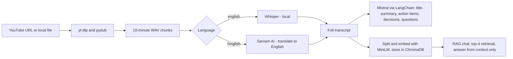

# AI Meeting Assistant

Turn any meeting recording or YouTube video into a transcript, a summary, action items and key decisions, then chat with it using retrieval-augmented generation (RAG).

## Features

- **Flexible input:** paste a YouTube URL or point to a local audio/video file. Audio is converted to 16 kHz mono WAV and split into 10-minute chunks.
- **Two transcription engines:**
  - English audio is transcribed locally with OpenAI Whisper.
  - Hinglish audio is transcribed and translated to English with the Sarvam AI speech-to-text-translate API.
- **Structured meeting notes** generated with Mistral through LangChain:
  - a short title (8 words or fewer)
  - a bullet-point summary (map-reduce over the full transcript)
  - action items with owner and deadline
  - key decisions
  - open questions
- **Chat with your meeting:** questions are answered from the transcript using ChromaDB retrieval. If the answer is not in the transcript, the assistant says so instead of guessing.

## How it works



| Stage | Details |
|---|---|
| Audio processing | `yt-dlp` downloads YouTube audio; `pydub` converts to 16 kHz mono WAV and chunks it |
| Transcription | Whisper (`small` by default) for English; Sarvam `saaras:v2.5` for Hinglish, sent in 25-second pieces because the API limit is 30 seconds |
| Summarization | 3,000-character chunks (200 overlap) summarized individually, then merged into a final summary |
| Extraction | Separate prompts for action items, decisions and open questions (temperature 0.2) |
| Retrieval | 500-character chunks (50 overlap), `all-MiniLM-L6-v2` embeddings, ChromaDB, top-4 similarity search |
| LLM | `mistral-small-latest` through LangChain Expression Language (LCEL) |

## Tech stack

| Area | Tools |
|---|---|
| Language | Python 3.10+ |
| Speech-to-text | OpenAI Whisper (local), Sarvam AI |
| LLM orchestration | LangChain (LCEL), Mistral AI |
| Embeddings and vector store | sentence-transformers (`all-MiniLM-L6-v2`), ChromaDB |
| Audio | yt-dlp, pydub, FFmpeg |
| Configuration | python-dotenv |

## Project structure

```
.
├── main.py                  # CLI entry point and pipeline orchestration
├── core/
│   ├── transcriber.py       # Whisper / Sarvam routing and chunked transcription
│   ├── summarizer.py        # Map-reduce summary and title generation
│   ├── extractor.py         # Action items, decisions and open questions
│   ├── vector_store.py      # Text splitting, embeddings and ChromaDB
│   └── rag_engine.py        # Retrieval-augmented question answering
├── utils/
│   └── audio_processor.py   # Download, convert and chunk audio
├── requirements.txt
├── .env.example
└── .gitignore
```

## Getting started

### Prerequisites

- Python 3.10 or newer
- [FFmpeg](https://ffmpeg.org/download.html) installed and available on your `PATH`
- A [Mistral API key](https://console.mistral.ai/)
- A Sarvam AI API key (only needed for Hinglish audio)

### Installation

```bash
git clone https://github.com/ParthaRoy10/ai-meeting-assistant.git
cd ai-meeting-assistant

python -m venv .venv
source .venv/bin/activate        # Windows: .venv\Scripts\activate

pip install -r requirements.txt
```

### Configuration

Copy the example file and add your keys:

```bash
cp .env.example .env
```

| Variable | Required | Description |
|---|---|---|
| `MISTRAL_API_KEY` | Yes | Mistral API key used for summaries, extraction and RAG answers |
| `SARVAM_API_KEY` | Only for Hinglish | Sarvam AI key for speech-to-text with translation |
| `WHISPER_MODEL` | No | Whisper model size: `tiny`, `base`, `small` (default), `medium`, `large` |
| `SARVAM_STT_MODEL` | No | Sarvam model name (default `saaras:v2.5`) |

## Usage

```bash
python main.py
```

You will be prompted for the input source and language:

```
Enter YouTube URL or local file path: <URL or path>
Language (english/hinglish): english
```

The assistant then prints the title, summary, action items, key decisions and open questions, and opens an interactive chat:

```
Chat with your meeting (type 'exit' to quit)

You: <your question>
Assistant: <answer drawn from the transcript>
```

Type `exit`, `quit` or `q` to leave the chat.

## Notes and limitations

- **First run is slower.** Whisper and the embedding model are downloaded on first use.
- **Reset between recordings.** The vector store is persisted in `vector_db/`. Delete that folder before analysing a different recording, otherwise old transcript chunks can appear in answers.
- **Privacy.** Whisper runs locally, but transcript text is sent to Mistral, and Hinglish audio is sent to Sarvam. Avoid confidential recordings unless that is acceptable.
- **Accuracy depends on audio quality.** Noisy audio and overlapping speakers reduce transcript quality, which affects every later step.
- **No speaker identification.** Action-item owners are inferred from the text of the transcript.

## Roadmap

- Streamlit web interface
- PDF and TXT export of the generated notes
- Per-recording vector collections

## Author

Built by [Partha Roy](https://github.com/ParthaRoy10).
